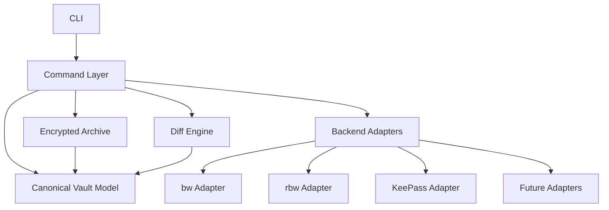

# Vault Backup Design

> Design record. The README and `docs/threat-model.md` describe current
> behavior; where they differ from this document, they take precedence.

## Goal

Build `yabbt`, a Rust CLI for complete password-vault backup, restore, diff, and future sync across Bitwarden, Vaultwarden, KeePass, and later password-manager backends.

The core product promise is completeness: if a backend exposes data to the user, `yabbt` must either export and restore it or clearly fail/report the unsupported data. Silent partial backups are bugs.

## Product Scope

`yabbt` is designed as an archive-first tool. A backup creates one compressed encrypted archive containing normalized vault data, attachments, integrity metadata, and reports. Restore and sync operate from that archive model rather than from a vendor export format.

Primary user workflows:

- Back up a Bitwarden or Vaultwarden account, including attachments.
- Verify an archive offline.
- Inspect an archive without leaking secrets by default.
- Diff a live account against an archive.
- Restore an archive into Bitwarden or Vaultwarden.
- Import an archive into KeePass with explicit lossy-mapping reports.
- Add future backends by implementing adapter traits.

## Architecture



The command layer owns user interaction, output formatting, and exit codes. The model layer owns portable vault semantics. The archive layer owns compression, encryption, checksums, manifests, and versioning. Adapters translate backend-specific objects to and from the canonical model.

## Canonical Model

The canonical model must preserve data needed for reliable restore and portability:

- Vault metadata: source backend, server URL, account/export scope, created timestamp, tool version.
- Containers: folders, organizations, collections, and membership relationships.
- Items: login, secure note, card, identity, SSH key, passkey-bearing item data where exposed, and unknown item payloads.
- Item properties: name, notes, favorite status, reprompt flags, timestamps, custom fields, URIs, TOTP, tags/folder links, collection links, and backend IDs as provenance.
- Attachments: original filename, backend attachment ID, parent item reference, size, checksum, media type if available, and archive path.
- Backend metadata: structured passthrough fields for data not yet represented in portable fields.
- Reports: completeness, warnings, unsupported features, and redacted command traces.

Stable IDs inside archives must not depend solely on target-backend IDs. They should be derived from source IDs plus source namespace where available, and fall back to generated archive-local IDs when needed.

## Archive Format

The archive is a compressed encrypted container with a versioned internal layout:

```text
manifest.json
vault.json
attachments/<item-stable-id>/<attachment-stable-id>.bin
blobs/
reports/export-report.json
```

`manifest.json` records format version, tool version, created time, source backend, source server, export scope, object counts, cryptographic parameters, compression parameters, and payload checksums.

`vault.json` contains the canonical model and references attachment/blob paths by stable archive IDs.

`reports/export-report.json` records completeness status, warnings, unsupported objects, backend versions, external command invocations with secrets redacted, and adapter capability snapshots.

The first implementation should use passphrase-based encryption. The design allows adding age recipient encryption later without changing the canonical model.

Compression happens before encryption. Integrity checks are stored inside encrypted metadata, with an additional outer checksum where practical for corruption detection before decryption.

## Adapter Contracts

Adapters are split into source and target roles:

- `VaultSource`: preflight, capability discovery, export into canonical model, attachment/blob streaming, and source report generation.
- `VaultTarget`: preflight, capability discovery, restore planning, restore execution, ID mapping, and post-restore verification support.

Every adapter exposes capabilities:

- Read/write items.
- Read/write attachments.
- Organizations and collections.
- Sends or equivalent shared objects.
- SSH keys and passkeys.
- Custom fields and backend metadata passthrough.
- Strict restore support.

Adapters must not hide unsupported data. If strict mode is enabled, unsupported required data fails the operation. In permissive mode, unsupported data is emitted in reports and, where possible, preserved as metadata.

## Backend Strategy

The first complete Bitwarden/Vaultwarden implementation should use the official `bw` CLI because it exposes the necessary primitives for attachment download and upload.

Bitwarden/Vaultwarden source flow:

- Run `bw sync`.
- Export JSON where useful for broad item coverage.
- Use `bw list items` to enumerate attachment metadata.
- Download each attachment with `bw get attachment`.
- Export organization scopes separately when requested.
- Fail or warn based on strictness if any attachment, item, or scope cannot be exported.

Bitwarden/Vaultwarden target flow:

- Preflight authentication, server URL, target scope, and available commands.
- Create folders/collections/items before attachments.
- Maintain a source-to-target ID map.
- Upload attachments with `bw create attachment`.
- Diff the target against the archive after restore.

The `rbw` adapter is planned behind the same traits. Its first useful version is likely a source/read adapter for normal item data, with explicit capability gaps for attachments and import. A hybrid mode can use `rbw` for convenient session UX and `bw` for attachment operations if that proves reliable.

KeePass is a target adapter. It writes KDBX4, mapping portable fields to KeePass entries/groups/binaries and preserving Bitwarden-specific metadata in namespaced custom fields where supported. Lossy mappings are reported.

Status: implemented, exceeding the original scope — KeePass is both a target (`restore --target keepass`, `sync --target keepass`, full planning/restore-map idempotency, attachments, prune via the KeePass Recycle Bin) and a source (`backup`/`diff`/`sync --source keepass`, including KeePassXC-authored databases). The verbatim item payload is preserved in the protected `yabbt.bitwarden_raw` custom field, which is what guarantees fingerprint-faithful round trips. Writes go through the keepass crate's experimental KDBX4 writer with a one-per-run `.bak` copy and atomic temp+rename saves. Follow-ups: keyfile support, a weak-passphrase policy for auto-created databases, keepass-to-keepass sync.

## CLI Design

Initial command surface:

```text
yabbt doctor
yabbt backup --source <adapter> --out <archive> [--yolo]
yabbt inspect <archive>
yabbt verify <archive>
yabbt diff --source <adapter> --archive <archive>
yabbt restore --target <adapter> <archive> --dry-run
yabbt restore --target <adapter> <archive> --apply
yabbt restore --target <adapter> <archive> --apply --verify-after
yabbt restore --target <adapter> <archive> --apply --update-existing
yabbt restore --target <adapter> <archive> --apply --no-restore-map
yabbt sync --source <adapter> --target <adapter>
```

Early implementation only needs fully functional `doctor`, `verify` for archives produced by tests, and library-level archive/model behavior. Commands that depend on live backends may exist as placeholders returning clear unsupported errors until their stage is implemented.

## Diff and Sync Semantics

Diff uses stable fingerprints computed from meaningful vault content. Volatile backend fields are ignored by default. The first implementation compares archive-vs-live items by item ID and prints counts plus item IDs only. JSON output is required for automation in a later stage; human output should be concise and secret-safe.

Sync is built from backup, diff, restore planning, and restore execution. It should not become a separate backend-specific shortcut. Initial sync is one-way and conservative:

- Dry run by default for target mutations.
- No destructive deletes unless explicitly requested.
- Archive-first mode before any target mutation.
- A restore plan is produced before applying changes.

Status: implemented for `bw -> bw` as `yabbt sync --source bw --target bw --source-profile <name> --target-profile <name>`, composed from the backup flow (archive-first), strict archive verification, and the restore flow against the target profile. The source profile is export-only by construction. Named persistent bw profiles (isolated `BITWARDENCLI_APPDATA_DIR` directories with interactive `bw` auth) carry the two accounts. Follow-up: source-organization export scope for sync; the source export is currently personal-vault scope.

Restore planning is read-only. The first implementation decrypts the archive, scans the target account where supported, builds a target-aware mutation plan, and prints counts, blockers, and item/folder IDs only. Human and JSON output are supported for the plan. Restore apply is conservative by default: it recomputes the plan, creates missing folders by exact name, rewrites item folder IDs to target-vault folder IDs, creates missing items, uploads attachments for newly created items, skips updates unless `--update-existing` is passed, and never deletes target-only folders or items. Destructive mirror behavior is available only through explicit `--prune`. Prune planning is dry-run safe and reports target-only item, attachment, and folder IDs. Apply recomputes the plan before mutation, sends item deletes to Trash by default, and requires `--prune-permanent` for irreversible item deletion. `--prune` does not imply `--update-existing`. Bitwarden organization and collection completeness is deferred to a later dedicated pass; the current implementation should keep guardrails so source organization and collection IDs are not replayed blindly. With `--update-existing`, missing archive attachments are uploaded to matched existing items without deleting or overwriting target attachments. Optional post-apply verification checks the target IDs returned by create/edit calls and uploaded attachment visibility without printing fetched item content or attachment names. A target-vault restore map item maintains source-to-target item mappings by default without adding metadata to every restored item; `--no-restore-map` opts out.

Backlog for organization/collection support:

- Record archive scope explicitly: personal vault or one source organization.
- Reject mixed personal-plus-organization archives and multi-organization archives.
- Model collections and target collection mapping before restoring collection-scoped items.
- Never restore source `organizationId` or `collectionIds` directly into a target vault.

## Security Requirements

Secrets must not be logged by default. Diagnostic reports may include command names, versions, object counts, IDs, and redacted stderr/stdout snippets, but not passwords, item secrets, TOTP seeds, notes, or attachment contents.

Temporary plaintext files must live in a controlled temporary directory and be deleted on success. Failure paths must report where temporary data remains if automatic cleanup is unsafe or incomplete.

Backlog: attachment backup/restore currently requires temporary plaintext attachment files because `bw get attachment --output <path>` and `bw create attachment --file <path>` are path-based. A later hardening stage should reduce this exposure where possible, for example by preferring memory-backed temporary directories, tightening permissions, improving failure cleanup reporting, or using streaming APIs if Bitwarden exposes them. Vault JSON and decrypted archive payloads should remain in memory and must not be written as standalone plaintext files.

Archive creation must refuse weak passphrases by default. Any override must be explicit and visible in the CLI, currently `backup --yolo`.

Archive verification must detect:

- Wrong passphrase.
- Unsupported archive version.
- Missing referenced attachment/blob.
- Checksum mismatch.
- Malformed manifest or vault model.

## Testing Strategy

Implementation should be test-first for core behavior.

Required test categories:

- Model round-trip tests for canonical vault fixtures.
- Archive encryption/decryption tests.
- Wrong-passphrase and tamper-detection tests.
- Manifest/object-count consistency tests.
- Attachment reference validation tests.
- Adapter capability contract tests.
- Golden diff tests.

Live Bitwarden/Vaultwarden integration tests must be opt-in through environment variables and must never target a real personal vault by default.

## Staged Delivery

Stage 0 creates the Rust project foundation, CLI skeleton, documentation, and test fixtures.

Stage 1 implements the canonical model and encrypted archive core.

Stage 2 implements Bitwarden/Vaultwarden export via `bw`.

Stage 3 implements inspect, verify, and diff.

Stage 4 implements Bitwarden/Vaultwarden restore via `bw`.

Stage 5 implements KeePass import.

Stage 6 implements the `rbw` adapter where capabilities allow.

Stage 7 implements conservative one-way sync.

Stage 8 hardens adapter extensibility for future targets.

## Acceptance Criteria

The product is complete when it can export, verify, diff, and restore Bitwarden/Vaultwarden data including attachments; import into KeePass with explicit lossy-mapping reports; and add a new backend through adapter implementations without rewriting the archive or diff layers.

Stage 0 and Stage 1 are complete when the project builds, tests pass, the CLI exposes the planned command names, the canonical model round-trips fixtures, and encrypted archives can be written, read, verified, and rejected when tampered with or decrypted with the wrong passphrase.
